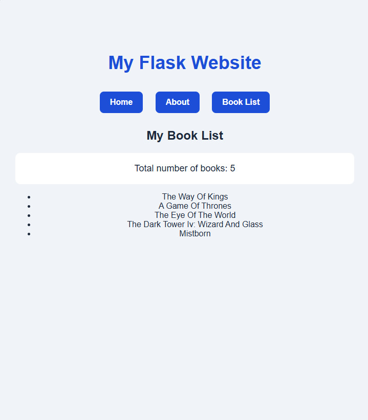

# My Website - Favorite Books

A simple website what gives some information about me as well as a favorite book list. 

## Built with 
    - Phython
    - Flask
    - HTML
    - CSS
    - Jinja2

## How to run it

    1. Open project folder in VS Code.
    2. Open the terminal.
    3. Activate the virtual environment.
    4. Run the Flask application
    5. Open the browser and visit the address given in the terminal

## Screenshot

